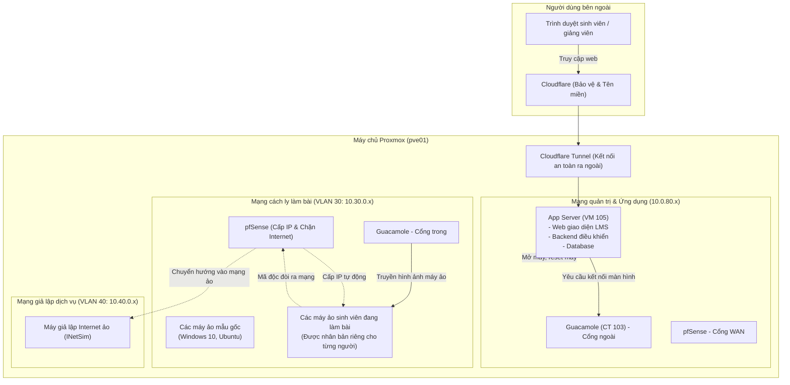

# TỔNG QUAN HẠ TẦNG PROXMOX VE - HỆ THỐNG MALSEC LMS

Tài liệu này giải thích cách bố trí và vận hành hạ tầng máy chủ Proxmox cho phòng lab thực hành phân tích mã độc MalSec. Mục tiêu là giúp người đọc hiểu rõ hệ thống đang chạy những gì, từng máy chủ làm nhiệm vụ gì và liên kết với nhau ra sao.

---

## 1. Bức tranh tổng thể

Thay vì để sinh viên tải mã độc về máy cá nhân chạy thử gây nguy cơ mất an toàn, toàn bộ quá trình phân tích được đưa lên máy chủ ảo hóa Proxmox. Người dùng chỉ cần mở trình duyệt web là có thể vừa xem tài liệu hướng dẫn, vừa thao tác trực tiếp trên máy ảo Windows hoặc Linux cô lập hoàn toàn.

---

## 2. Các vùng mạng được chia như thế nào?

Hệ thống tách biệt hoàn toàn thành 3 dải mạng để mã độc không thể lây lan:

1. **Dải mạng Quản trị (Management - 10.0.80.x)**: 
   * Đây là khu vực nội bộ đặt máy chủ điều khiển, web app và Proxmox. 
   * Khu vực này có đường kết nối mạng thông suốt để quản trị viên làm việc và để web app giao tiếp với hệ thống ảo hóa.

2. **Dải mạng Phòng Lab (Sandbox VLAN 30 - 10.30.0.x)**:
   * Đây là nơi sinh viên thực hành kích hoạt và mổ xẻ mã độc.
   * Dải này bị **ngắt hoàn toàn đường ra Internet thật** và không thể đi ngược về mạng quản trị hay mạng cơ quan/trường học. Sinh viên cũng không thể quét mạng hay gửi file sang máy của bạn học cùng lớp nhờ tường lửa chặn kết nối ngang hàng.

3. **Dải mạng Giả lập (INetSim VLAN 40 - 10.40.0.x)**:
   * Khi mã độc chạy lên, nó thường tìm cách liên hệ với máy chủ điều khiển của hacker (C2 server) qua tên miền hoặc web. 
   * Dải mạng này đóng vai trò "đóng kịch", giả vờ trả lời các yêu cầu DNS/HTTP/Mail của mã độc để người học quan sát được hành vi mạng của virus mà không để lộ lưu lượng thật ra ngoài thế giới.

---

## 3. Từng thành phần làm nhiệm vụ gì?

### 3.1. Máy chủ vật lý Proxmox VE (`pve01`)
* **Vai trò**: Là người quản gia điều hành toàn bộ phần cứng (CPU, RAM, ổ cứng).
* **Nhiệm vụ**:
  * Chứa và chạy tất cả các máy ảo con.
  * Tự động nhân bản (clone) một máy ảo mới toanh từ máy gốc khi sinh viên bắt đầu làm bài, hoặc xóa đi tạo lại khi sinh viên muốn làm lại từ đầu.
  * Đóng gói sẵn các bộ công cụ phân tích mà giảng viên yêu cầu rồi tự động nhét vào ổ đĩa `D:\` của máy ảo sinh viên.
* **Tầm quan trọng**: Là nền tảng bên dưới cùng. Nếu máy chủ vật lý tắt hoặc trục trặc phần cứng, toàn bộ hệ thống sẽ dừng hoạt động.

### 3.2. Tường lửa pfSense (VM 100) — "Người gác cổng" an ninh mạng
* **pfSense là gì trong hệ thống?**
  Nó là một máy ảo chạy hệ điều hành pfSense CE 2.7.0 (2 vCPU, 2GB RAM), đóng vai trò như chiếc router/firewall chuyên dụng đứng giữa thế giới bên ngoài và thế giới phòng lab.

* **Cách cắm dây mạng ảo (3 Card mạng):**
  pfSense cắm 3 "chân" vào 3 khu vực khác nhau:
  1. **Chân WAN (`10.0.80.5`)**: Nối vào mạng quản trị `vmbr0`. Chân này chỉ dùng để liên lạc trong nội bộ máy chủ, hoàn toàn khóa cổng quản trị web từ phía ngoài để tránh bị can thiệp.
  2. **Chân LAN (`10.30.0.1` - VLAN 30)**: Chân cắm thẳng vào phòng lab của sinh viên. Đây là cổng mặc định (Default Gateway) của toàn bộ máy ảo Windows/Ubuntu sinh viên đang làm bài.
  3. **Chân OPT1 (`10.40.0.1` - VLAN 40)**: Chân cắm sang khu vực giả lập mạng (INetSim).

* **Nhiệm vụ cụ thể hàng ngày:**
  * **Cấp phát IP tự động (DHCP Server)**: Khi hệ thống MalSec nhân bản ra một máy ảo mới cho sinh viên, máy ảo đó sẽ gửi tín hiệu xin IP. pfSense lập tức cấp một địa chỉ IP riêng trong dải `10.30.0.x`, kèm theo địa chỉ Gateway là chính nó (`10.30.0.1`). Nhờ đó, máy ảo sinh viên tự động có mạng nội bộ để Guacamole kết nối vào mà không cần ai phải vào chỉnh tay.
  * **Chặn đứng mọi ngả đường ra Internet (Egress Drop)**: Đây là nhiệm vụ sống còn. Khi sinh viên chạy thử một mẫu virus, ransomware hay trojan, mã độc thường tìm cách kết nối ra ngoài để tải thêm mã độc phụ hoặc gửi dữ liệu đánh cắp về máy chủ của kẻ tấn công (C2 server). pfSense sẽ "bắt gọn" các gói tin này tại Gateway `10.30.0.1` và DROP (vứt bỏ) ngay lập tức. Mã độc hoàn toàn bị "mù" và bị nhốt trong phòng lab.
  * **Bảo vệ mạng trường học và máy chủ quản trị**: pfSense chặn triệt để chiều đi từ mạng sinh viên (`10.30.0.x`) sang mạng quản trị (`10.0.80.x`). Nhờ vậy, dù máy ảo sinh viên có bị chiếm quyền hoàn toàn thì virus cũng không thể mò sang máy chủ web, database hay máy chủ Proxmox.
  * **Cầu nối sang mạng giả lập (Fake Network)**: Khi cần phân tích hành vi mạng của virus, thay vì để nó ra Internet thật, pfSense phối hợp điều hướng các truy vấn DNS/Web sang dải VLAN 40 (nơi có INetSim đóng giả làm Internet).

* **Điểm cần lưu ý về mặt kỹ thuật:**
  * pfSense làm việc ở **Tầng mạng (Layer 3)**: Nghĩa là nó chỉ kiểm soát được những gói tin **đi qua nó** (từ dải này sang dải khác, hoặc đòi ra ngoài). 
  * Các máy ảo sinh viên cùng nằm trong dải `10.30.0.x` sẽ giao tiếp với nhau qua switch ảo ở **Tầng liên kết dữ liệu (Layer 2)** mà không đi qua pfSense. Do đó, để sinh viên không quét mạng hoặc gửi file phá máy nhau, hệ thống phải kết hợp thêm tầng tường lửa hạt nhân của chính Proxmox (Proxmox VE Firewall) ngay trên card mạng của từng máy ảo.
* **Tầm quan trọng**: Cực kỳ then chốt. Nếu pfSense bị tắt hoặc cấu hình sai, máy ảo sinh viên sẽ không nhận được IP (khiến màn hình web bị đen, không kết nối được VDI), hoặc nguy hiểm hơn là mã độc có thể thoát ra ngoài Internet thật.

### 3.3. Máy chủ ứng dụng MalSec (VM 105 - `ubuntu-105`)
* **Vai trò**: Là bộ não quản lý toàn bộ trải nghiệm người dùng và nghiệp vụ lớp học.
* **Nhiệm vụ**:
  * Chạy giao diện website LMS nơi sinh viên đăng nhập, đọc đề bài, xem hướng dẫn và nộp báo cáo.
  * Giúp giảng viên quản lý danh sách lớp, tạo bài thực hành, chấm điểm bài nộp và theo dõi tiến độ sinh viên.
  * Khi sinh viên bấm "Bật máy làm bài", chính máy chủ này sẽ bí mật ra lệnh cho Proxmox chuẩn bị máy và mở màn hình cho sinh viên.
  * Lưu trữ tài khoản, lớp học, lịch sử bài nộp vào cơ sở dữ liệu PostgreSQL.
* **Tầm quan trọng**: Là điểm tiếp xúc trực tiếp của người dùng. Nếu máy chủ này gặp lỗi, sinh viên và giảng viên sẽ không thể vào website hay tương tác với bài lab.

### 3.4. Cổng truyền hình ảnh Guacamole (CT 103)
* **Vai trò**: Là chiếc cầu nối hiển thị màn hình máy ảo lên trình duyệt.
* **Nhiệm vụ**:
  * Kết nối trực tiếp vào giao diện đồ họa (RDP của Windows hoặc XRDP của Ubuntu) của máy ảo sinh viên, sau đó biến đổi thành hình ảnh truyền mượt mà về trình duyệt web.
  * Nhờ có thành phần này, sinh viên chỉ cần dùng một chiếc laptop bình thường mở Chrome hay Cốc Cốc là đã có thể điều khiển máy ảo mà không cần cài thêm bất kỳ phần mềm phức tạp nào.
* **Tầm quan trọng**: Quyết định độ mượt mà khi sinh viên thao tác chuột và bàn phím. Nếu Guacamole bị treo, sinh viên vào web vẫn thấy giao diện nhưng màn hình máy ảo sẽ báo mất kết nối.

### 3.5. Các máy ảo mẫu gốc (Master Templates - VM 1001, 1003)
* **Vai trò**: Là "khuôn đúc" chứa đầy đủ đồ nghề thực hành.
  * **VM 1001**: Máy Windows cài sẵn môi trường FLARE-VM với đủ các công cụ dịch ngược, gỡ lỗi (x64dbg, IDA Pro, Ghidra, PE-bear, Process Hacker...).
  * **VM 1003**: Máy Ubuntu Desktop phục vụ các bài thực hành dịch ngược mã độc trên Linux.
* **Nhiệm vụ**: Luôn nằm yên ở trạng thái tắt để giữ dữ liệu sạch sẽ, làm nguồn sao chép cho hàng chục sinh viên cùng lúc.
* **Tầm quan trọng**: Đảm bảo mọi sinh viên trong lớp đều có một môi trường phân tích tiêu chuẩn, giống hệt nhau, không bị thiếu sót công cụ.

### 3.6. Máy ảo của sinh viên (Student Clones - dải 10000 trở lên)
* **Vai trò**: Là bàn làm việc riêng của từng sinh viên.
* **Nhiệm vụ**:
  * Mỗi sinh viên khi vào làm một bài lab sẽ được cấp riêng một máy độc lập, mang mã số gắn liền với tài khoản của mình.
  * Sinh viên có quyền quản trị tối cao (Admin/root) trên máy này để thoải mái cài cắm, dịch ngược hoặc chạy thử file mã độc.
  * Nếu lỡ tay làm hỏng hệ điều hành hoặc máy bị virus phá hủy, chỉ cần bấm nút "Khôi phục / Reset" trên web là máy sẽ được làm mới lại như lúc ban đầu chỉ sau vài giây.
* **Tầm quan trọng**: Là không gian thực chiến chính của người học.

### 3.7. Cổng kết nối Cloudflare (Cloudflare Tunnel)
* **Vai trò**: Là đường dây an toàn đưa trang web MalSec ra ngoài Internet.
* **Nhiệm vụ**:
  * Giúp sinh viên và giảng viên ở nhà hoặc bất kỳ đâu cũng vào được trang `malsec.iahn.hanoi.vn` để làm bài.
  * Điểm đặc biệt là hệ thống không cần phải mở cổng (port forward) bừa bãi trên router của cơ quan hay trường học, giúp che giấu toàn bộ địa chỉ IP máy chủ thật khỏi sự dò quét của hacker trên mạng.
* **Tầm quan trọng**: Cung cấp đường truyền ổn định, an toàn và chống tấn công từ chối dịch vụ (DDoS) từ ngoài Internet.

---

## 4. Những điều cần nhớ khi vận hành

1. **Không đụng vào các máy chủ gốc có số hiệu nhỏ hơn 1000**:
   Các máy như pfSense (`100`), Guacamole (`103`), App Server (`105`) là bộ khung sống còn của hệ thống. Các thao tác dọn dẹp máy ảo tự động của hệ thống chỉ được phép đụng vào dải máy sinh viên (`10000` trở lên).
2. **Tuyệt đối không cấp Internet cho máy sinh viên**:
   Trong mọi tình huống, không được mở mạng ra ngoài cho dải VLAN 30 vì mục đích của phòng lab là giam giữ mã độc an toàn.
3. **Cập nhật công cụ bài học đúng cách**:
   Khi muốn cài thêm phần mềm vào máy mẫu gốc (`1001`, `1003`), giảng viên cần chụp một bản lưu trạng thái (snapshot), bật lên cài đặt, kiểm tra xong phải tắt máy hẳn về trạng thái dừng thì sinh viên mới có thể nhân bản bài làm trơn tru.
